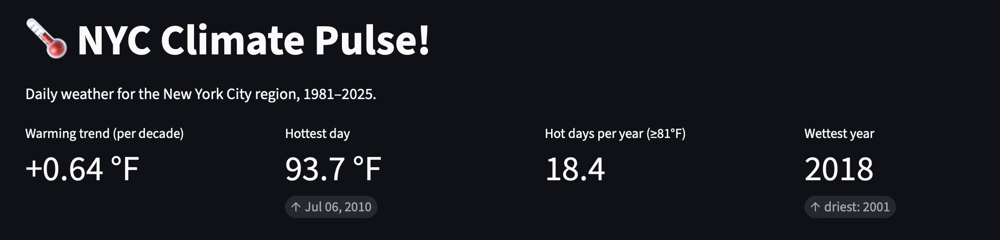
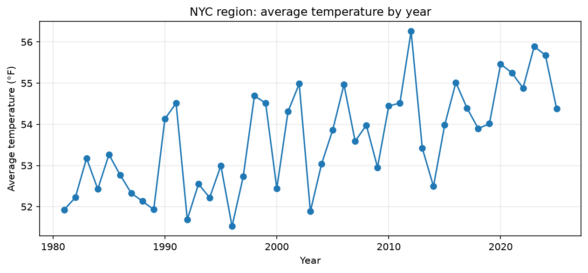

# 🌡️ NYC Climate Pulse

**How has New York City's weather changed since 1981?**
This project pulls 45 years of daily weather data from NASA, cleans it, measures the warming trend, forecasts tomorrow's high, finds heat waves and droughts, and shows it all in a live dashboard.

👉 **Live dashboard:** PASTE_YOUR_STREAMLIT_LINK_HERE



---

## Key findings

| Question | Answer |
|---|---|
| How fast is the region warming? | About **+0.64 °F per decade** |
| Hottest day on record (1981–2025) | **July 6, 2010**, with a high of **93.65 °F** |
| Hot days a year (high of 81 °F or more) | Up from **12.3** in the early years to **24.1** recently. 2010 had **43**. |
| Heat waves (3+ hot days in a row) | **103** in total. They doubled, from **1.5 a year** (1981–2000) to **3.0 a year** (2006–2025). |
| Worst drought | The 90 days ending **Nov 18, 2024**, with only **16% of normal rain** |
| Wettest / driest year | **2018** / **2001** |
| Best forecast of tomorrow's high | **Random forest**, off by **3.20 °F** on average |



The full story, with what each number means, is in **[docs/findings.md](docs/findings.md)**.

---

## What's inside

```
nyc-climate-pulse/
├── data/
│   └── nyc_daily_1981_2025.csv   # the daily weather data
├── notebooks/                     # one notebook per sprint
│   ├── 01_data_pull.ipynb         # download the data from NASA
│   ├── 02_...                     # explore, clean, first charts
│   ├── 03_...                     # warming trend and hot days
│   ├── 04_...                     # forecast tomorrow's high
│   └── 05_anomalies.ipynb         # heat waves, droughts, unusual days
├── src/
│   └── nasa_power.py              # reusable code to call the NASA API
├── app/
│   ├── app.py                     # the Streamlit dashboard
│   └── requirements.txt           # packages the online dashboard needs
├── docs/
│   ├── findings.md                # the write-up
│   └── images/                    # screenshots used in this README
├── requirements.txt               # packages to run everything locally
└── README.md                      # this file
```

---

## Run it yourself

You need Python 3 and Git. These steps are for macOS (Terminal).

```bash
# 1. Download the project
git clone https://github.com/NixAILearn/nyc-climate-pulse.git
cd nyc-climate-pulse

# 2. Make a virtual environment and turn it on
python3 -m venv .venv
source .venv/bin/activate

# 3. Install the packages
pip install -r requirements.txt

# 4. Start the dashboard (it opens in your browser)
streamlit run app/app.py
```

To explore the notebooks, run `jupyter notebook` and open the `notebooks/` folder.

The data file is already in `data/`, so you don't need to download anything else. To pull fresh data, run `notebooks/01_data_pull.ipynb`.

---

## The data and its limits

- **Source:** [NASA POWER](https://power.larc.nasa.gov/) daily point data for the NYC area, 1981–2025. It's free and needs no API key.
- **What's measured:**

  | Column | Meaning |
  |---|---|
  | `T2M` | Average air temperature 2 m above ground (°C) |
  | `T2M_MAX` | Daily high (°C) |
  | `T2M_MIN` | Daily low (°C) |
  | `PRECTOTCORR` | Rain and snow, as water (mm per day) |
  | `RH2M` | Relative humidity (%) |

- **Limits to keep in mind:**
  - NASA POWER is a model built from satellites and weather data, not a single thermometer. Each value covers a grid cell about **50 km wide**, so it describes the **NYC region**, not a borough or a street. The city center is hotter than the grid average because of the urban heat island.
  - Gridded data smooths out extremes. Real station highs (for example, Central Park) are often a few degrees hotter than the numbers here.
  - "Hot day" means a high at or above the 95th percentile of this dataset (about 81 °F). That is a relative threshold, not an official heat advisory.

---

## What I learned

This was my first data project. Along the way I learned Python, pandas, matplotlib, scikit-learn, Jupyter, Streamlit, and Git/GitHub, working in seven small sprints:

0. Setup · 1. First data pull · 2. Explore and clean · 3. Warming trend · 4. Forecast tomorrow's high · 5. Heat waves and droughts · 6. Dashboard · 7. README and write-up

## Ideas for later

- **Part 2:** neighborhood heat islands, using Landsat satellite images and the NYC street tree census.
- Compare against the Central Park weather station.
